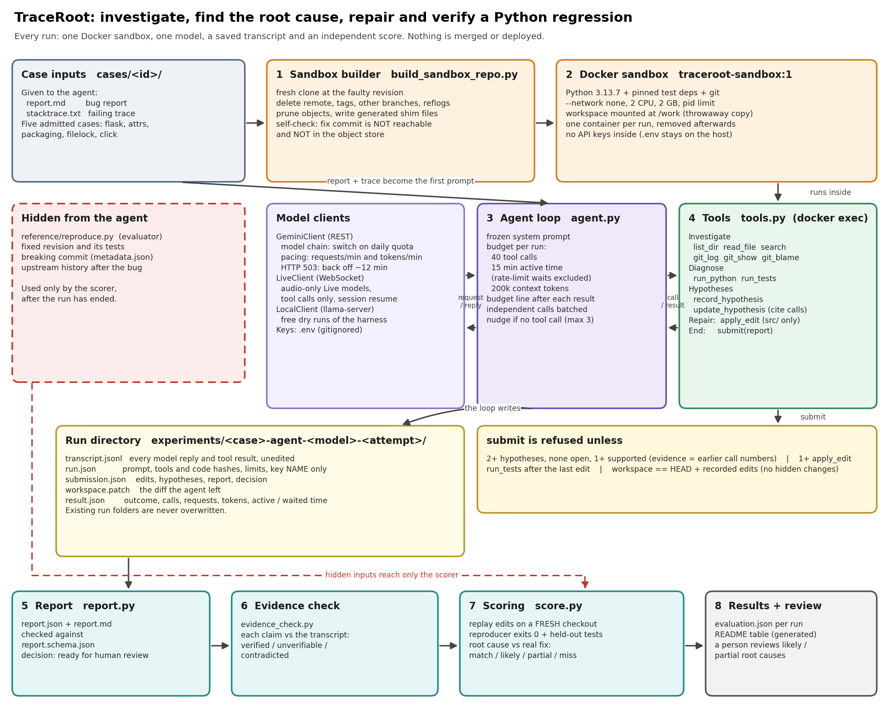

# TraceRoot

TraceRoot tests whether an AI agent can handle a Python regression the way a careful developer would. A change broke a
working feature and a test fails. The agent investigates the repository, its tests and its Git history. It weighs
competing hypotheses with diagnostic checks, applies the smallest justified fix and verifies it. The output is an
auditable report: patch, root cause, evidence, test results and limitations, ready for human review. Nothing is merged or
deployed automatically.

The project has two parts:

1. **Baseline**: a single prompt (bug report and stack trace in, one patch out), scored by an independent evaluator.
2. **Investigator agent**: a tool-using agent in a Docker sandbox, scored by the same evaluator plus root-cause and
   evidence checks.

## Architecture



Regenerate with `python tools/scripts/draw_architecture.py` (needs matplotlib).

How one agent run works:

1. **Sandbox builder** (`tools/scripts/build_sandbox_repo.py`): fresh clone at the faulty revision. It removes the fix
   commit, tags, other branches and reflogs, then checks that the fix is not reachable and not in the object store.
2. **Docker sandbox** (`tools/sandbox/`): no network, CPU and memory limits, one container per run, no API keys inside.
3. **Agent loop** (`tools/agent/agent.py`): drives the model with function calling. The budget is 40 tool calls,
   15 minutes of active time (rate-limit waits are excluded and recorded) and 200k context tokens.
4. **Tools** (`tools/agent/tools.py`): read, search, Git history, run Python, run tests, record and resolve hypotheses,
   edit files under `src/`, submit.
5. **Submit gates**: submit is refused until there are at least two resolved hypotheses (one supported, with cited tool
   calls), at least one edit, a test run after the last edit, and a workspace equal to HEAD plus the recorded edits.
6. **Report** (`tools/agent/report.py`): builds `report.json` and `report.md` and checks them against `report.schema.json`.
7. **Evidence check** (`tools/agent/evidence_check.py`): checks every claim in the report against the saved transcript and
   marks it verified, unverifiable or contradicted.
8. **Scoring** (`tools/agent/score.py`): replays the edits on a fresh checkout. The reproducer must exit 0 and the held-out
   upstream tests must pass. It also compares the reported root cause with the real fix.

The agent never sees the reference reproducer, the fixed revision, its tests or the breaking commit. Only the scorer uses
them, after the run has ended.

## Quick start

Requirements: Git, Docker, Python 3.13.

```
# 1. Python environment for the evaluator and the harness
python -m venv .venv
.venv\Scripts\python -m pip install -r tools\sandbox\requirements.txt websockets

# 2. Upstream clones (not stored in Git; URL in cases/<id>/metadata.json, key project_url)
git clone https://github.com/pallets/click cases\click-3449\upstream
#    ...and the same for the other four cases

# 3. Sandbox image
docker build -t traceroot-sandbox:1 tools\sandbox

# 4. API key in a .env file at the repo root (gitignored)
#    GEMINI_API_KEY=...
#    GEMINI_API_KEY_2=...        (optional, select with --key-env=GEMINI_API_KEY_2)
```

Offline self-tests (no API calls):

```
.venv\Scripts\python -I tools\agent\selftest_tools.py click-3449
.venv\Scripts\python -I tools\agent\selftest_agent.py
.venv\Scripts\python -I tools\agent\selftest_evidence.py
.venv\Scripts\python -I tools\agent\selftest_score.py
.venv\Scripts\python -I tools\agent\selftest_e2e.py filelock-346
```

Run the agent:

```
# one case
.venv\Scripts\python -I tools\agent\agent.py filelock-346 experiments\filelock-346-agent-<model>-a <model>
.venv\Scripts\python -I tools\agent\score.py experiments\filelock-346-agent-<model>-a

# all five cases with one model, scored, skipping folders that already exist
.venv\Scripts\python -I tools\agent\run_batch.py gemini-3.5-flash-lite a

# rebuild the results table at the end of this README from the run folders
.venv\Scripts\python -I tools\scripts\make_results_table.py
```

Model names:

- A plain Gemini model id uses the REST API.
- A comma-separated list is a chain: the run moves to the next model when one model's daily quota ends.
- A name containing `-live` uses the Live API over WebSocket. These models answer in audio, so only their tool calls are
  used.
- A name starting with `local` uses llama-server on `127.0.0.1:8091` for free harness dry runs.

Before real runs, read `docs/RUN_CHECKLIST.md`.

## Repository layout

| Path | Contents |
| --- | --- |
| `cases/<id>/` | `metadata.json`, `report.md` and `stacktrace.txt` (model inputs), `reference/` (evaluator only), `upstream/` (local clone, not in Git) |
| `tools/agent/` | agent loop, tools, sandbox wrapper, report, evidence check, scoring, batch runner, self-tests |
| `tools/sandbox/` | Dockerfile and pinned requirements of the sandbox image |
| `tools/scripts/` | sandbox builder, baseline runner, case admission, diagram and results table generators |
| `experiments/` | one folder per run: inputs, unedited outputs, `evaluation.json`; agent runs also keep `transcript.jsonl` and reports |
| `docs/` | design (`investigator-design.md`), progress notes, run checklist, case research, architecture diagram |

Rules:

- Nothing from a case's `reference/` folder goes into a model input.
- Saved outputs are never edited. Existing run folders are never overwritten.
- A failed attempt is kept and reported. A rerun gets a new letter (`a`, `b`, `c`) and the reason is written down.
- Results are reported only after the commands have actually run.

## Cases

Five real regressions from public projects. Each case is validated on the faulty and the fixed revision with a reproducer
and targeted tests, and the breaking commit was found with `git bisect run` (see `docs/benchmark-candidate-research.md`):
`flask-5160`, `attrs-1416`, `packaging-638`, `filelock-346`, `click-3449`.

## Baseline results (single prompt, 2026-10-24)

The model gets the bug report and stack trace (`a`), or those plus a source excerpt built from the stack trace (`b`), and
returns one search/replace edit block (`experiments/PROTOCOL_EDIT_FORMAT.md`). `tools/scripts/run_edit_experiment.py`
applies the edits and runs the evaluator. Each cell is one attempt with greedy decoding. `n/a` means the trace has no
project frames, so there is no `b` variant.

| Case | Qwen3-8B a | Qwen3-8B b | Gemini 3.5 Flash a | Gemini 3.5 Flash b |
| --- | --- | --- | --- | --- |
| flask-5160 | patch_does_not_apply | evaluator_still_fails | patch_does_not_apply | **success** |
| attrs-1416 | patch_does_not_apply | n/a | patch_does_not_apply | n/a |
| packaging-638 | patch_does_not_apply | evaluator_still_fails | **success** | **success** |
| filelock-346 | patch_does_not_apply | evaluator_still_fails | evaluator_still_fails (cap64k) | **success** (cap64k) |
| click-3449 | patch_does_not_apply | evaluator_still_fails | patch_does_not_apply (cap64k) | invalid_output_contract |

Totals over the 9 runs per model: Qwen3-8B 0 successes; Gemini 3.5 Flash 4 successes.

Notes:

- An earlier diff-format protocol failed at `git apply` in all four runs (Qwen3-8B v2 and v3, Gemini 3.5 Flash a and b),
  which is why the edit format was introduced. The two protocols are reported separately. Run v1 is invalid because its
  response was lost before it was saved.
- `cap64k` rows were rerun with the output cap raised to 65,536 tokens. The first runs (cap 16,384) stopped at `MAX_TOKENS`
  after about 15.7k thinking tokens and produced no edit. They are recorded as `output_limit_reached`.
- `click-3449` Gemini `b` wrote a plausible edit but added prose outside the code block, which the contract rejects.
- Qwen3-8B `attrs-1416 a` copied the prompt's placeholder path `src/example/module.py`, so that wording may have misled the
  small model.
- Evaluator tests for the four newer cases are the upstream versions at the fixed revision.
- Gemini runs hit HTTP 503 several times; those requests were repeated with identical settings.

## Investigator agent results (separate from the baseline tables above)

Agent: `tools/agent/agent.py` (tools, hypotheses, budgets and report checks as in `docs/investigator-design.md`):
40 tool calls, 15 minutes of active time (rate-limit waits excluded and recorded), 200k context tokens. All runs on the
Gemini free tier, 2026-10-31. One model per driver, except the labelled Flash chain, which moves to the next model when one
model's daily quota ends. "Success" is the same independent evaluator as the baseline: the submitted edits replayed on a
fresh checkout, reproducer exits 0, held-out upstream tests pass. Root cause: `match` = breaking commit named; `likely` = same
file and function as the real fix (a person should confirm the mechanism); `partial` = file or function only; `miss`.
Evidence = items in the report backed by the transcript / all items checked (`tools/agent/evidence_check.py`, checker a7f25b9).

| Driver | filelock-346 | packaging-638 | attrs-1416 | click-3449 | flask-5160 | Solved |
| --- | --- | --- | --- | --- | --- | --- |
| Gemini 3.1 Flash Live (preview) | **success**, root cause likely, evidence 14/16 | **success**, root cause partial, evidence 12/16 | no submit (40 calls used) | **success**, root cause partial, evidence 19/21 | **success**, root cause match, evidence 10/13 | 4/5 |
| Gemini 3.5 Flash Lite | no submit (40 calls used) | **success**, root cause partial, evidence 7/11 | **success**, root cause likely, evidence 4/6 | no submit (40 calls used) | **success**, root cause miss, evidence 7/10 | 3/5 |
| Gemini 3.1 Flash Lite | no submit (40 calls used) (b) | **success** (b), root cause partial, evidence 9/9 | **success** (c), root cause likely, evidence 12/14 | no submit (40 calls used) | **success**, root cause likely, evidence 19/20 | 3/5 |
| Gemini 3.8 Live | no submit (40 calls used) (c) | **success** (c), root cause partial, evidence 11/11 | no submit (40 calls used) (c) | no submit (40 calls used) (c) | **success** (c), root cause match, evidence 8/10 | 2/5 |
| Flash chain (3.8 Flash, 3 Flash, 2.5 Flash) | **success** (b), root cause likely, evidence 10/13 | **success** (b), root cause partial, evidence 17/17 | stopped: empty or malformed model reply (c) | no submit (15 active minutes used) (b) | **success** (b), root cause match, evidence 12/17 | 3/5 |

Cases solved by at least one driver: 5 of 5. Baseline for comparison (single prompt, edit format): Gemini 3.5 Flash 4 of 9 runs.

Reruns and exclusions (every attempt is kept in `experiments/`; the table shows the last attempt, letter in brackets):
- Gemini 3.8 Live `a` and `b` failed because of harness bugs in the Live client (an empty turn-closing message was read as an
  empty answer, so the agent was nudged out after about 4 calls). Fixed in c21045a and f44b893, then `c` ran.
- Gemini 3.1 Flash Lite `a` lost filelock, packaging and attrs to HTTP 503 (Google "high demand") before 503 patience was added;
  `b` reran those three. attrs `b` again stopped on 503 after 12 retries; `c` reran attrs and solved it.
- Flash chain `a` lost every case to HTTP 503 or to a harness bug (missing thought signature after a model switch). `b` reran with
  the fixes on the first key and stopped at attrs when the last model's daily quota ended. click `b`, flask `b` and attrs `c` then
  ran on a second key (`run.json` records `key_env`). click `b` used up the 15 active minutes in 10 calls (Gemini 3.8 Flash took
  90 to 185 s per reply). attrs `c` ended when Gemini 2.5 Flash returned `MALFORMED_FUNCTION_CALL`; the loop treats an empty reply
  as the end of the run instead of nudging, a harness weakness to fix in the next protocol version.
- Gemini 3.8 Live Extended Thinking was dropped: it answered in speech and made no tool calls (all five `a` runs).
- The very first run (filelock, Gemini 3.5 Flash) stopped on the 20 request daily quota after 22 calls, before any edit.

Limits of these results:
- Five public bugs, one counted attempt per cell. Indicative only; the models may have seen these fixes in training.
- `likely` and `partial` root causes have not yet been reviewed by a person.
- The free tier may use prompts to improve Google products; the cases are public repositories.
